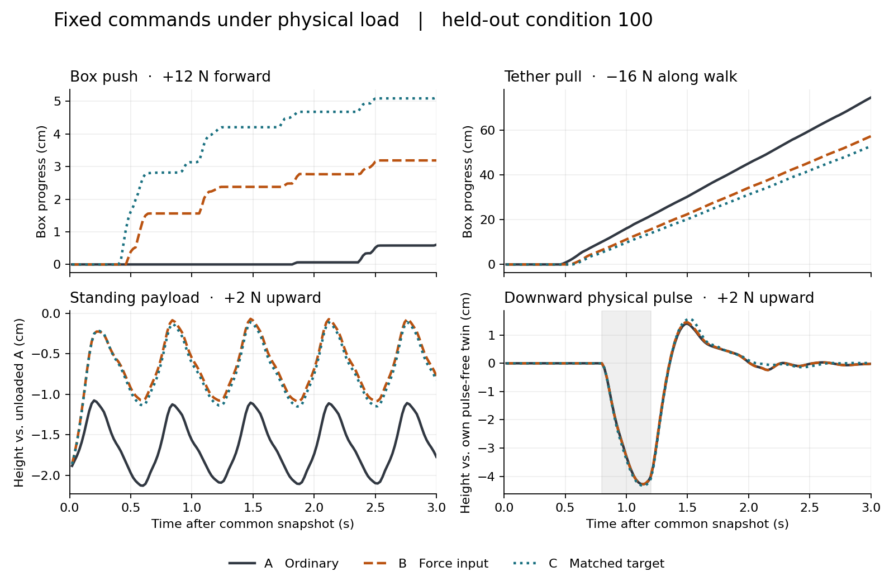

# What does UniFP force conditioning add at fixed commands?

**The clearest matched-target benefit occurred during slow towing.** With −16 N of virtual base force along the walk direction, the conditioned actor tracked the shared effective velocity better than the zero-force actor in all 12 loaded cases. Disconnecting the cable reversed that ordering in all 12. The speed offsets measured in free walking explain much of this interaction. For forward pushing, upward payload compensation and recovery from a downward finger load, ordinary target changes reproduced or exceeded most of the useful physical response. [Primary measurements](fixed_policy_load_trials.csv) · [Pulse measurements](fixed_finger_pulse_trials.csv)



## Paired protocol

Each trial used the existing native encoder–actor and actuator loop at 50 Hz with four MuJoCo substeps per action. After a common warmup, each branch restored the full physical state, 32-frame history, previous action, gait clock and actuator queues. It then held one 12-slot raw policy command for 3 s. The actor continued receiving new physical observations. A supplied the nominal command, B added a signed virtual force, and C supplied the equivalent ordinary target with zero virtual force. Each sign comparison shares one A trajectory. Metrics below are equally weighted means of per-condition measurements over the entire window, including the initial command step and contact-free periods. [Trial implementation](../tests/fixed_policy_loads.py) · [Native state and measurements](../native/world.h)

- **EE target.** In the gravity-aligned frame at root position plus yaw-rotated (0.35, 0, 0.12) m, the training position target is the Cartesian decoding of the issued spherical command plus (virtual + independently scheduled external EE force)/200 N/m. C encodes this displaced point back into radius, elevation and azimuth. All nominal and matched commands were strictly inside 0.15–0.55 m, −40° to 50°, and ±90°. B and C matched within **0.060 µm** when decoded at the same measured pose and rotated into world coordinates. Their later root poses can differ. [Training geometry](../../unifp-spot/unifp_spot/envs/unifp_env.py) · [Rewards](../../unifp-spot/unifp_spot/envs/base/mdp/rewards.py)
- **Base target.** The XY training target adds (virtual + separately scheduled external base force)/200 N·s/m to the nominal XY velocity, then zeroes XY if both components are ≤0.1 m/s in magnitude and the yaw rate is ≤0.2 rad/s in magnitude. All tested walking commands remained active. C matched B within **3.0 × 10⁻⁸ m/s**. We scored actual velocity using the inverse full base rotation, as in the reward. Contact, payload gravity and tendon tension affect dynamics. They do not populate the separately scheduled external training stream. [Velocity reward](../../unifp-spot/unifp_spot/envs/base/mdp/rewards.py) · [Shared velocity calculation](../tools/base_load_mpc.py)
- **Actor input.** Raw EE/base force occupies slots 6–8/9–11 and enters the observation scaled by 0.01. Training limits are ±40/30 N per component. XY velocity is scaled by 2, yaw rate by 0.25. The largest first-tick B–C joint-action differences averaged 0.130–0.132 across signs for pushing, 0.053–0.058 for towing, and 0.011 for payloads. These comparisons were made before trajectories diverged. [Training observations](../../unifp-spot/unifp_spot/envs/base/mdp/observations.py) · [Spot configuration](../../unifp-spot/unifp_spot/envs/spot/spot_pos_force_cfg.py)

Development used conditions 0 and 1. The first payload pilot at ±8 N shifted the target by 40 mm while measured load sag was only 7–15 mm. We selected ±2 N for the comparison before running conditions 100–111. The held-out set contains 12 distinct placements for the 1 kg push, four of the same placements at 2 kg, 12 towing conditions, and 12 mass/posture pairs evaluated both standing and walking. Every 2 kg placement was given a 1 kg twin, independent of outcome. The pulse used 12 reproducible posture/load combinations. These are repeated deterministic comparisons within the same physics model and checkpoint. The 150 ticks of one trial are one trajectory.

## Box pushing

The 0.40 × 0.40 × 0.50 m free box used the established 0.30 sliding friction and mass-scaled solid-cuboid inertia. Box centers were sampled at x = 1.015–1.080 m and y = ±0.045 m. Spot warmed up contact-free for 1 s, then held zero base velocity and a yaw-frame EE point (0.44, 0, −0.17) m relative to the sphere center. B added ±12 N along yaw X. C shifted X by ±0.06 m. Forces below act on the box, with forward defined as world +X. Impulse integrates the native substep forces. Duty counts 5 ms substeps with hand load above 1 N. Peak is the mean of each episode’s peak forward force.

| 1 kg, 12 placements | Forward travel (cm) | Peak XY speed (m/s) | Forward impulse (N·s) | Mean / peak forward force (N) | Duty | Max lateral travel (mm) | Effective EE RMS error (mm) |
|---|---:|---:|---:|---:|---:|---:|---:|
| A ordinary | 1.60 | 0.090 | 0.90 | 0.30 / 15.27 | 4.5% | 1.3 | 56.0 |
| B +12 N | 4.27 | 0.224 | 1.58 | 0.53 / 22.89 | 8.0% | 4.5 | 75.5 |
| C +6 cm | 6.16 | 0.278 | 2.04 | 0.68 / 28.52 | 10.0% | 9.6 | 68.4 |
| B −12 N | 0.24 | 0.025 | 0.19 | 0.06 / 4.00 | 1.1% | 0.08 | 52.9 |
| C −6 cm | 0.03 | 0.009 | 0.04 | 0.01 / 2.58 | 0.3% | 0.02 | 48.9 |

Both positive treatments moved every 1 kg box at least 1 cm. A did so in 6/12, negative B in 2/12, and negative C in 0/12. Positive C pushed farther than B in 12/12 and produced larger average peaks and lateral travel. At 2 kg, mean A/B+/C+ progress was **0.35 / 2.44 / 3.94 cm**, compared with **0.59 / 3.18 / 5.10 cm** at the same four placements at 1 kg. Negative treatments produced zero forward displacement at 2 kg. All measured nongripper impulses were zero. Peak torso tilt was 8.74°. Fixed reach and brief contact limit the scope of this push.

## Tethered locomotion

The native 70 cm unilateral cable connected the rear torso hitch to the box eye. Held-out models spanned 1–3 kg, floor friction 0.27–0.40, initial slack 8–14 cm, and spawn yaw −15° to +18°. The neutral arm stayed at (0.35, 0, 0.10) m. After 1 s of slack warmup, fixed yaw-frame walks ranged from 0.252–0.319 m/s and −11.0° to +11.8° about body forward, with yaw rate zero. B supplied ±16 N along that body-frame walk vector. C changed speed by ±0.08 m/s. Each run also had a disconnected twin with identical warmup states and actions. The free box in that twin remained stationary. [Tether model and force validation](tether.md)

| Treatment | Box travel in 3 s (cm) | Time to 25 cm (s) | Max lateral drift (cm) | Effective velocity RMS error, loaded / free (m/s) | Tension mean / peak (N) | Taut duty |
|---|---:|---:|---:|---:|---:|---:|
| A ordinary | 63.36 | 1.60 | 3.84 | .0607 / .0512 | 5.67 / 50.36 | 74.4% |
| B +16 N | 80.68 | 1.34 | 4.83 | .0832 / .0689 | 5.93 / 58.85 | 76.1% |
| C +0.08 m/s | 85.24 | 1.29 | 5.28 | .0739 / .0643 | 6.00 / 61.39 | 76.0% |
| B −16 N | 45.98 | 2.03 | 2.78 | .0425 / .0425 | 5.28 / 41.20 | 72.3% |
| C −0.08 m/s | 41.50 | 2.12 (11/12) | 2.41 | .0486 / .0391 | 5.15 / 37.30 | 70.7% |

Negative B improved loaded effective-speed tracking and box progress over negative C in **12/12**. Its mean free-walking along-command velocity was 0.0090 m/s above their shared target. C was 0.0067 m/s below. Connecting the cable reduced these speeds by **0.0249 / 0.0239 m/s**, respectively. The pre-existing speed bias helps explain the ranking reversal under load. Case 111 with negative C traveled 24.08 cm in 3 s and is censored for time to 25 cm. Positive C tracked better and traveled farther than positive B in all 12 cases. Both force signs gave a smaller speed change than issuing the full equivalent velocity shift directly.

In the first 0.5 s after tension exceeded 0.1 N, effective-velocity RMS errors for A/B+/C+/B−/C− were **.038 / .057 / .043 / .029 / .038 m/s**. Confirming 0.2 consecutive seconds within 0.08 m/s took **.20 / .32 / .20 / .20 / .20 s** from first tension. Tension peaks reached 88.79 N across runs. Peak torso tilt was 10.43°. No direct robot–box contact or loaded cable crossing was recorded.

## Rigid EE payload

The payload was a rigid inertial load centered at the existing finger COM, modeled as a 4 cm-radius solid sphere. Adding mass there preserves the COM and adds `2mr²/5` to each principal inertia. It introduces no extra joint or collision surface. The 12 sampled loads were 0.365–0.987 kg (3.58–9.68 N weight). At spawn, the change in generalized gravity load matched `−J_COMᵀ m g` to 10⁻¹⁰. A zero-added-mass rebuild reproduced all actions, positions and velocities of a six-second original-model walk exactly.

For each load, one local EE target was sampled from x = 0.30–0.42 m, y = ±0.05 m, z = 0.03–0.12 m. Both standing and 0.20 m/s forward walking used 2 s of nominal warmup. We compared ±2 N vertical commands with ±10 mm position offsets. Each treatment also ran on its own unloaded twin. **Unloaded-posture error** measures how well each loaded hand reproduced the original unloaded A world-height trajectory. **Nominal error** measures vertical distance from the prescribed position goal evaluated at the current root. These questions give different answers because UniFP already has tracking error and gait motion in free space.

| Treatment | Unloaded-posture RMS, stand / walk (mm) | Nominal RMS, stand / walk (mm) | Effective RMS, stand / walk (mm) | Mean finger height, stand / walk (cm) |
|---|---:|---:|---:|---:|
| A ordinary | 12.88 / 12.94 | 13.95 / 12.04 | 13.95 / 12.04 | 70.37 / 70.52 |
| B +2 N | 5.53 / 5.41 | 13.62 / 13.54 | 13.98 / 12.06 | 71.35 / 71.50 |
| C +10 mm | 5.74 / 5.58 | 13.50 / 13.41 | 13.97 / 11.94 | 71.32 / 71.48 |
| B −2 N | 22.57 / 22.74 | 19.75 / 16.95 | 14.11 / 12.26 | 69.39 / 69.54 |
| C −10 mm | 22.20 / 22.48 | 19.59 / 16.91 | 14.09 / 12.34 | 69.43 / 69.56 |

Both upward treatments recovered much of the unloaded posture in every case. B’s additional mean improvement over C was **0.21 mm standing and 0.18 mm walking**. The load still lowered B’s own height by 12.27 / 12.37 mm relative to its same-command unloaded twin. For C these shifts were 12.22 / 12.36 mm. Neither improved mean walking RMS error to the original nominal target. Lowering the target worsened unloaded-posture tracking.

Replaying the actual ONNX actions through the native delayed drives reproduced every 50 Hz joint sample at float32 precision and exposed all four applied torque samples per tick. Seven arm/finger motors had roughly 9.1–9.3 N·m RMS torque across treatments. The largest applied torque was 26.86 N·m. Only the finger motor reached its limit. On walking trials the mean fractions of all seven motor-substep samples at a limit were 1.69% / 1.55% / 1.76% for A/B+/C+. Mean payload COM displacement over 3 s was 5.9 / 5.8 / 5.9 cm standing and 62.3 / 62.5 / 62.5 cm walking. The standing command allows body sway and drift. Maximum loaded torso tilt was 8.32°.

## Physical finger disturbance

In a separate standing test, MuJoCo applied a world-downward force at the finger COM for 0.40 s, beginning 0.80 s after the common snapshot. Held-out physical loads ranged from 6.84 to 11.74 N. Virtual commands remained fixed for the full 3 s. Each treatment also ran a pulse-free twin with bit-identical state through onset. An airborne 20 ms check measured additional system momentum of (0.00011, −0.00053, −0.19817) N·s for a requested (0, 0, −0.20) N·s impulse. [Pulse diagnostic](../tests/fixed_finger_pulse.py)

| Across 12 pulses | A ordinary | B +2 N upward | C +10 mm |
|---|---:|---:|---:|
| Peak finger drop relative to own twin (mm) | 32.86 | 32.84 | 33.07 |
| RMS error to nominal height during pulse (mm) | 26.19 | 20.43 | 20.86 |
| Peak arm-joint deviation from twin (rad) | .0470 | .0465 | .0468 |
| Recovery after removal, within 5 mm for 0.20 s (s) | .668 | .668 | .673 |

All 36 episodes recovered within 0.78 s of pulse removal. Raising the target before the pulse reduced absolute error during loading, while the physical deflection and recovery stayed similar. The data support a position bias and provide little evidence of greater disturbance rejection.

## Implication for MPC

Keep ordinary position and velocity as the default controls. The towing result warrants a fixed ordinary-speed comparison with roughly a 0.015 m/s adjustment to test whether ordinary velocity can reproduce the slower conditioned gait under load. For the next cone experiment, first fork actual cone-contact snapshots and test a **single signed EE component at a time**, horizontal and vertical. Pair each with its reachable position offset and score signed cone angular impulse, axis progress and clean release. Advance a component to CEM only if the physical outcome improves reproducibly at matched targets. The present experiments cover free-space vertical loading and short planar pushes. Cone contact leverage remains untested.

## Reproduce

Run these from the repository root with the prepared scenes and exported policy. The pulse wrench hook and torque readout are compiled only into the existing test probe.

```bash
pixi run --locked build
for split in development held; do
    pixi run --locked env PYTHONPATH=build:tools OPENBLAS_NUM_THREADS=1 python tests/fixed_policy_loads.py "$split"
    pixi run --locked env PYTHONPATH=build:tools python tests/fixed_finger_pulse.py "$split"
done
```

The scripts write per-condition CSVs and measured time series under `artifacts/fixed_policy_loads/`. The four supplemental 1 kg placements have traces under `held/one_kg_twins/`. The plots can be regenerated with `python tests/plot_fixed_loads.py` in a Python environment with NumPy and Matplotlib. The tests use checkpoint export SHA-256 `4b1f0b65467b3f85cef03f97a77f79988da138cc627d2219f909a87100a2c060`.
