# UniFP-MPC: whole-body manipulation with a pretrained position–force policy

**Technical research report · MuJoCo experiments · frozen benchmark and supplemental studies**

[Illustrated HTML edition](research_report.html) · [Video gallery](video_gallery.md) · [Experiment inventory and reproduction guide](research_evidence.md) · [Statistical tables](report_data/)

## 1. Executive summary

A sampling planner can steer a pretrained Spot policy to approach an object, establish contact, push it to a position, tip it and release it, or tow it on a cable. Each candidate runs the actual neural policy and actuator model inside MuJoCo. The planner sees the consequences for the object before choosing the next 100 ms of commands. The same policy weights serve every task. The key experimental question is whether steering the policy through its **virtual force inputs** buys anything beyond steering it through ordinary position and velocity.

The clearest affirmative result is a short push with a **prespecified 50 mm destination**. A +12 N virtual command and an ordinary +60 mm reach had the same effective tracking target. The force-conditioned policy delivered a smaller, less sideways impulse and left more boxes *settled* at the goal. It gained five settlements over the matched reach in the original twelve placements, three in twelve fresh placements, and five when those **same fresh placements** carried 1.5 kg. A separately calibrated ordinary reach came within 0.54 mm of the conditioned policy's **mean endpoint accuracy** at 1 kg, yet settled zero boxes to its three. This is a replicated advantage for one schedule and hold criterion. It does not establish a force servo or a general advantage for optimizing force.

In the **538 frozen MPC episodes on 51 physical scenes**, ordinary UniFP settled 12/30 general boxes, released 18/24 general cones and delivered 17/24 tethered boxes. Goal-axis force reduced mean box error from 54.9 to 39.9 mm but settled one fewer box. Vertical force released 20/24 cones against 18/24 for its reachable vertical-position control. Full XYZ force released 16/24 against 19/24 for its match. Ordinary and base-force MPC solved the same 17 tether assignments. The paired uncertainty intervals allow effects in either direction. On heavy outward-facing cones the dominant difficulty was acquiring contact with leverage. Accurate prediction of a nearly immobile cone often coexisted with failure.

**SUMO/ReLIC was better at some aspects of the tasks.** Its registered controller settled 21/30 common boxes and brought all 24 cones through its native orientation threshold. Nine cones completed the strict hand-free hold, one with clean contact throughout. At a comparable planning time and the same 10 Hz frequency, supplemental ReLIC settled 17/30 boxes and released 15/24 cones. Ordinary UniFP's 18 releases were all clean. ReLIC retained a proximity reward at upright, while UniFP rewarded release and rejected nongripper collisions. A two-start ReLIC reward ablation converted both sustained-contact timeouts into releases. Cross-system differences reflect complete architectures.

On eight CPU cores UniFP's pooled general-task planning p95 was 43 ms for pushing, 60–63 ms for uprighting and 80–81 ms for towing. General cone planning exceeded 100 ms on 49 of 8,193 updates. Simulation demonstrates task feasibility, learned behavioral differences and conditional advantages. It leaves real-world performance and a general ranking of controllers open. [Frozen episodes](final_trials.csv) · [Supplemental handoff](supplemental_results.md) · [Regenerated group statistics](report_data/mpc_groups.csv)

## 2. Research question and contributions

SUMO asks whether short simulated futures of a pretrained controller can guide whole-body interaction at test time. Its registered Spot implementation samples planar base motion and arm joint targets. A locomotion policy generates leg actions and servos track the arm requests. UniFP learns a different interface. Its history-conditioned whole-body actor coordinates the arm and legs in response to position, velocity and virtual force. A high-level hand command must go through that actor before the simulation can predict the actual contact. The original works motivate the design; the results here concern the local Spot checkpoint, robot models and shared fixtures. [Zhang et al., *Sumo: Dynamic and Generalizable Whole-Body Loco-Manipulation*](https://arxiv.org/abs/2604.08508) · [Zhi et al., *Learning a Unified Policy for Position and Force Control in Legged Loco-Manipulation*, CoRL 2025](https://proceedings.mlr.press/v305/zhi25a.html)

This work contributes a native UniFP policy-in-the-loop simulator with delayed drives and exact branching, a receding-horizon controller for three manipulation tasks, physically matched controls for testing force conditioning, an execution/prediction split for controlled uncertainty, and an instrumented comparison against the released ReLIC system. The sampling and knot updates draw on Judo, and SUMO provided the predictive design, cone model and reference objectives. UniFP command projection, policy history, actuator integration, task costs, safety tests, matched-target experiments, cross-model state transfer and the common external scoring are local adaptations. The checkpoint is from the independent UniFP-Spot implementation. [UniFP-Spot dd97c6a](https://github.com/faffonso/unifp-spot/tree/dd97c6aaf1c4e7c57a0283599f04f10adf7ff5d2) · [SUMO 4cea4e4](https://github.com/rai-opensource/sumo/tree/4cea4e4e229ac075219ba3a3919c8e6e5f84f228) · [Judo 96d6f45](https://github.com/rai-opensource/judo/tree/96d6f451f482d68c903e17b223577b752319b4d1) · [Build and source identities, including SUMO's pinned Judo a2da9f5](final_lock.json)

## 3. Architecture and physical measurements

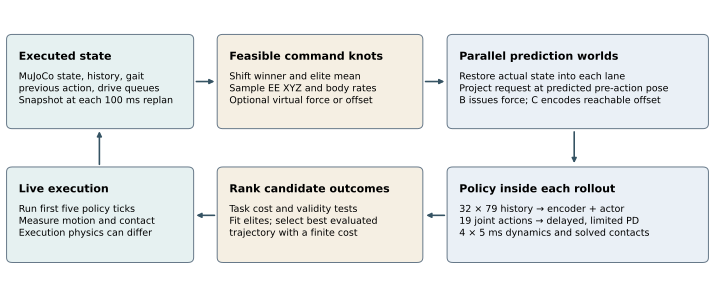

*Figure 1. One UniFP replan. Each prediction lane owns its dynamic state and calls the same low-level step as execution. Only the high-level prefix crosses back into execution. The next snapshot comes from the resulting live state.* [Native world](../native/world.h) · [Rollout pool](../native/rollouts.h) · [CEM](../tools/cem.py) · [Planning loop](../tools/box_mpc.py)

### The low-level loop

At 50 Hz the newest 79-element observation enters an oldest-first, zero-padded 32-frame buffer. Frame entries 0–4 contain roll/pitch and body angular velocity; 5–42 hold joint displacements from default and scaled velocities; 43–61 hold the previous action; 62–63 are sine/cosine of a 0.64 s gait clock. Entries 64–78 encode the body velocity, spherical hand target, three zero orientation entries, and virtual hand and torso forces. Angular velocity uses scale 0.25, joint velocity 0.05, requested XY speed 2, yaw rate 0.25 and both virtual forces 0.01. The exported adaptation encoder maps the 2,528 values to 64 latent values. The actor takes the newest frame and that latent and returns 19 joint-position actions. Each target is the joint's default plus 0.25 times its action. Joint names mediate the different policy and MJCF orderings. The actor requires no object pose or force sensor. The high-level planner does use simulator object state and contact measurements. [Export](../tools/export_policy.py) · [Frame, action and joint ordering](../README.md#policy-and-model-contract)

Four 5 ms MuJoCo steps follow each action. The drives implement joint-specific gains, delayed position targets, angle-dependent knee torque limits and motor saturation. For example, leg PD gains are 120/3 and the recorded knee lag is two physics steps. The seven arm/finger lags are 2, 0, 3, 0, 1, 1 and 3 steps. These states affect whether a contact can be reproduced from a branch. Each native worker has its own MuJoCo data, delay ring, tensors and policy state. Workers share the read-only model and a single-thread-per-inference ONNX Runtime session. Python constructs proposals, scores returned trajectories and chooses the winner. [Drives](../native/plant.h) · [Native trace API](../native/world.cpp)

### Three ways to request the same interaction

Let **R** be the pre-action root yaw rotation. The hand-command origin is root position plus **R**(0.35, 0, 0.12) m. Native conversion subtracts that origin, rotates the world request into yaw axes, then bounds radius to 0.15–0.55 m, elevation to −40…50° and azimuth to ±90°. Let **p** denote the resulting nominal world point. For the virtual-only comparison, the training EE reward target is **p + R F/200**, with stiffness in N/m. For the base the adjusted XY target is **v + (Fᵥ + Fₑ)ₓᵧ/200** in yaw axes, with damping in N·s/m. If both adjusted components are within ±0.1 m/s and commanded yaw rate is within ±0.2 rad/s, the linear tracking target is zero. The reward compares to measured velocity in the full body frame. Separately scheduled external EE forces can enter the training EE target too. Object reaction, weight and cable tension do not automatically populate that training channel. [Training rewards](../../unifp-spot/unifp_spot/envs/base/mdp/rewards.py) · [Command implementation](../native/world.h) · [Base-force formulation](base_load.md)

| Treatment | Input supplied to the actor at a common state | Interpretation |
|---|---|---|
| A · ordinary | Nominal position/velocity, zero virtual force | Reference authority and ordinary search |
| B · conditioned | Nominal projected position/velocity and issued virtual force | Changes both the reward target and explicit actor input |
| C · matched | Reachable displaced ordinary position/velocity, zero virtual force | Same effective target as B at the same pose. In MPC the offset has B's dimensionality and budget |
| D · calibrated | Ordinary reach chosen on separate development placements | Additional fixed-goal pushing comparator only |

A same-nominal A–B comparison combines two effects. B–C isolates the conditioning pathway in a single restored-state intervention. In independent MPC runs B–C measures the joint effects of conditioning, subsequent state divergence and candidate selection. EE/base virtual limits are ±40/30 N per component from training. The manipulation search caps base rates at ±0.35, ±0.22 m/s and ±0.5 rad/s; the locomotion rate planner uses the trained ±0.6, ±0.4 m/s and ±0.6 rad/s. Reach slew is 0.5 m/s, base command slew 0.8 per second per axis, requested force slew 80 N/s. The native projector shortens a force-offset ray at its first workspace boundary, including interior radius/elevation extrema. Raw proposal continuity therefore need not imply issued-force continuity on a moving base. Cone XYZ is yaw-relative; the signed horizontal box component follows the world goal axis and is converted at each tick. Towing uses a 30 N horizontal norm limit and constrains both nominal and displaced velocities. [EE controls](cone_force.md) · [Base rate sampler](../tools/base_load_mpc.py)

### Planning, state transfer and sensing

The cross-entropy method (CEM) evaluates piecewise linear command schedules with three knots. The hand can vary at both future knots. Each compact rate or force component ramps to a sampled middle value and then holds it. The first request is anchored at the last executed request. The batch includes the shifted incumbent and fitted mean; other draws vary around the distribution within bounds. The elite fit updates the distribution, and the best *evaluated eligible candidate* supplies five policy ticks. The winner, mean and spread shift forward for the next 10 Hz update. A finite horizon can rank small movements that enable later contact only insofar as their value is visible in the task cost. A batch with no eligible trajectory is an experimental outcome. [Implementation](../tools/cem.py) · [Rate planner](../tools/base_load_mpc.py)

A snapshot contains the full MuJoCo integration state, solver warm start, warning state, previous action, history, policy tick/gait phase, delay queues and last contact summary. For separate-model prediction, the pool registers a compatible clone for execution. Topology and controller-state semantics are preserved by construction. Identical physics retains the solver seed. With changed physics the nominal solver rebuilds constraints with a cleared acceleration warm start and past contact summaries. Applied external loads are hidden unless the experiment makes them known. State transfer preserves what the robot actually did while letting the predictor be wrong about what happens next. [Transfer tests](../tests/check_model_transfer.py) · [Model uncertainty](model_uncertainty.md)

At each integrated substep, hand contact includes the finger and distal wrist. The solved contact-frame wrench is rotated into world axes and signed **on the object**. Ground vertical force is positive upward. Unwanted robot–object contacts integrate separate impulse magnitudes. Tick resultants average all substeps, including zeros. The cross-system hand impulse integrates the norm of that tick-mean vector; signed downrange impulse, sums of individual wrench norms and signed angular impulse are different statistics. Tether tension comes from the unilateral constraint multiplier. Wall compression is world +X. In the videos a raw hand request uses pre-action coordinates, a physical finger is post-action, and the displayed future belongs to the winning forecast. A virtual force input has units N but supplies no physical wrench by itself. [Contact observer and checks](final_methods.md) · [Dashboard signal definitions](episode_telemetry.md)

## 4. Cohorts, treatments and scoring

| Evidence block | Assignment and experimental unit | Claim it supports |
|---|---|---|
| Frozen general UniFP | 15 boxes × 2 seeds × 3 arms; 12 cones × 2 × 5; 12 tethers × 2 × 3 = **282** | Performance within each specified general distribution |
| Frozen heavy challenges | Six boxes and six outward cones × 2 seeds × 3 arms × blind/informed = **144** | Consequence of changing model knowledge on the same heavy plants |
| Frozen ReLIC | 54 common assignments × native/equal-work, plus four assignments in the original runtime-calibrated subset = **112** | Complete-system comparison on the same general boxes and cones |
| Supplemental runtime | 54 assignments on those **same** 15 box/12 cone scenes | 10 Hz comparison with development-calibrated planning time |
| Supplemental robot/ground uncertainty | Six development episodes; three fresh starts per task, one optimizer seed, 54 nominal-predictor and 12 informed episodes | Small paired robustness study |
| Raw policy and development | Full-state forks, independently drawn placements/loads, repeated optimizers, historical regressions, selected examples | Policy mechanism, design choices and demonstrated feasibility; sample sizes appear by study |

The frozen total is **538 episodes across 51 physical scenes**: 39 general and 12 challenge. Optimizer seeds 311 and 337 are paired. All valid assigned failures remain. No warm starts were excluded. The protocol added three general-tier boxes before evaluation; the earlier proposed twelve-box matrix is historical. The supplemental runtime cohort reuses common geometries and optimizer seeds. The original and fresh fixed-goal pushes use 24 distinct placements in total. The two fresh mass conditions are paired interventions on twelve placements. [Frozen protocol](frozen_protocol.md) · [Actual seeds, poses, goals, friction, timeouts and hashes](final_scenes.csv) · [Prior proposal](final_evaluation.md)

**Physical criteria.** Score at 100 ms boundaries after neutral warmup. For a box, require final XY error ≤15 mm at every one of 25 policy ticks, and XY speed ≤0.02 m/s at every one of the last five ticks. For fixed commands that run a full 3 s, the main outcome requires that hold **at the end**. For a cone, report first local +Z alignment with world up ≥0.9 (about 25.84°), then separately require 25 consecutive ticks at ≤10°, angular speed ≤0.25 rad/s, ground support ≥half object weight, no active hand contact in any substep, robot height ≥0.35 m and peak absolute roll/pitch <30°. For towing require 25 ticks within 50 mm at ≤0.08 m/s, with collision and cable checks. Clean physical success on box/cone additionally requires stable posture and zero unintended impulse through completion. Strict release already rules out hand support during the hold. The live fall guard is less restrictive than the scoring posture threshold. [External scorer](../tools/physical_score.py) · [Cable scoring](../tools/tether_mpc.py)

**Inference.** Continuous endpoint statistics include timeouts, falls and early invalid-plan stops. “Success time” is simulated time after warmup. Paired completion-time differences use only assignments both arms solved; this conditions on success. Assignment-level errors and treatment win/loss counts use all pairs. Descriptive 95% percentile intervals use 10,000 resamples of physical scenes, retaining both optimizer repeats and all paired treatments. Fixed-command intervals resample placements within a particular cohort and mass. Six-scene challenge intervals are coarse; a degenerate bootstrap interval at zero successes provides no distribution-free upper bound. Timing percentiles pool actual plans for computational characterization. Policy ticks, contacts and optimizer repeats of one spawn do not count as new geometries. For secondary tasks with two placements, individual results are more informative than population inference. [Per-arm distributions including SD, range, percentiles, RMS and mean absolute value](report_data/mpc_distributions.csv) · [Paired contrasts](final_pairs.csv) · [Raw-policy and secondary summaries](report_data/policy_and_secondary.csv)

## 5. What the raw policy does at fixed high-level commands

Each comparison starts after a shared warmup with identical simulation and controller state. Commands then stay fixed or follow the prescribed schedule. The neural policy still reacts to proprioception every 20 ms. These experiments isolate policy response without making any MPC-versus-non-MPC task comparison.

### 5.1 Export, actuation and free-space reach

The iteration-5300 checkpoint exports to a float32 encoder–actor graph, opset 18. On eight synthetic histories the maximum ONNX–PyTorch action discrepancy was 2.86×10⁻⁶. Reconstructing 79 entries on 600 archived source frames gave maximum error 7.06×10⁻⁶; forward kinematics differed by at most 0.75 µm on 200 recorded poses. At matched targets and joint states all 152 recorded actuator torque samples matched exactly; signed saturation tests differed by at most 3.82×10⁻⁶ N·m. These validate interface, indexing and actuation. In free motion a 0.30 m/s request produced 0.2987 m/s in MuJoCo versus 0.2942 m/s in the archived source simulation. Mean reach error was 5.17 versus 5.02 cm. +20 N virtual forward shifted the hand 3.51 cm in MuJoCo; the equivalent +10 cm ordinary command shifted it 5.65 cm. The archived source responses were 3.62 and 5.76 cm. All manipulation results in this report execute in MuJoCo. [Validation and archival provenance](../README.md#previously-verified-inference-and-kinematics) · [Actuator check](../tests/check_actuators.py)

### 5.2 Movable obstruction and signed pushes

A contact-free 1 s warmup preceded a 3 s reach toward a 0.40 × 0.40 × 0.50 m cuboid. The arm point relative to the yaw-frame sphere center was (0.44, 0, −0.17) m; base velocity stayed zero. A 1 kg box lay at x = 1.015–1.080 m, y within ±0.045 m, floor sliding coefficient 0.30. Cases 100–111 followed two development conditions. B supplied ±12 N along yaw X and C shifted X by ±60 mm. At a common pose B/C matched to within 0.060 µm; the first actor actions differed before contact.

| Command · 12 paired placements | Forward travel, cm | Max lateral travel, mm | Forward impulse, N·s | Mean / peak forward load, N | Loaded duty | Effective EE RMS error, mm |
|---|---:|---:|---:|---:|---:|---:|
| A | 1.60 | 1.3 | 0.90 | 0.30 / 15.27 | 4.5% | 56.0 |
| B +12 N | 4.27 | 4.5 | 1.58 | 0.53 / 22.89 | 8.0% | 75.5 |
| C +60 mm | 6.16 | 9.6 | 2.04 | 0.68 / 28.52 | 10.0% | 68.4 |
| B −12 N | 0.24 | 0.08 | 0.19 | 0.06 / 4.00 | 1.1% | 52.9 |
| C −60 mm | 0.03 | 0.02 | 0.04 | 0.01 / 2.58 | 0.3% | 48.9 |

The positive ordinary offset pushed farther than B on all twelve placements. Four mass-matched 2 kg repeats gave A/B+/C+ 0.35/2.44/3.94 cm. Larger displacement here measures physical response. The goal study below tests its usefulness. A separate free-space twin moved the box 3 m away on the original fixed-goal protocol. Effective-target RMS error for obstructed A/B/C was 56.0/75.5/68.4 mm and 56.0/75.3/68.2 mm without the obstruction. At the end of the obstructed reaches the errors were still 32.4/49.4/41.3 mm. Most observed separation was already present without loading. These finite-duration tests establish neither perfect reachability nor a position-error model for arbitrary contacts. [Signed pushing data](fixed_policy_load_trials.csv) · [Obstruction and free controls](supplement_push.csv) · [Selected paired motion](video_gallery.md)

### 5.3 Fixed-goal pushing: reaching a position and staying there

The destination was fixed **50 mm world-forward** from the settled center before testing. All three arms used the schedule above. An independent calibration tried +20, +35 and +50 mm ordinary adjustments on six development placements (5001–5006), selecting +20 mm by mean endpoint error. D then stayed fixed through fresh evaluation and mass transfer. No goal distance was fit to a held-out trajectory.

| Physical conditions | A ordinary | B +12 N | C matched +60 mm | D ordinary +20 mm |
|---|---:|---:|---:|---:|
| Original 1 kg, 4101–4112 | 1 / 30.2 | **5 / 14.8** | 0 / 20.9 | — |
| Fresh 1 kg, 5101–5112 | 1 / 26.8 | **3 / 18.9** | 0 / 25.4 | 0 / 19.4 |
| Same twelve fresh placements, 1.5 kg | 0 / 30.0 | **5 / 18.3** | 0 / 23.3 | 0 / 20.5 |

Cells give **end-settled runs out of 12 / mean final XY error in mm**, including all misses. On the original cohort B's endpoint error was lower than C's in 7/12 pairs, with a mean B−C difference of −6.1 mm (95% paired placement interval −14.0 to +2.5). On both fresh mass conditions B won 8/12 error pairs against C and 7/12 against D. On fresh 1 kg B−D was −0.54 mm (−7.31 to +6.17); the median endpoint error actually favored D, 12.5 versus B's 19.8 mm. Mean and median endpoint error alone would miss the important distinction.

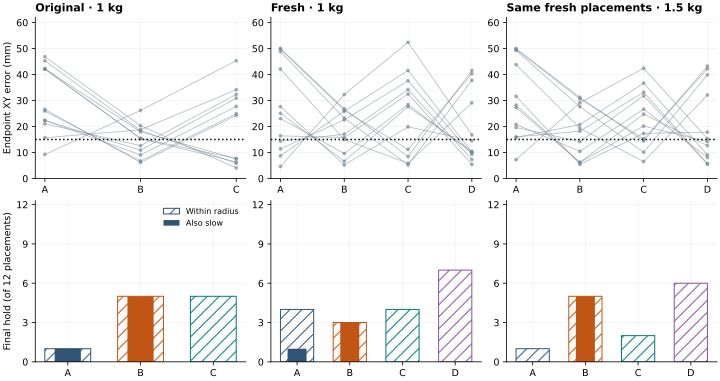

*Figure 2. Each line joins one placement across treatments. The dotted line marks the endpoint radius. The lower panels test the entire last half-second inside that radius (hatched) and the final speed condition as well (solid). The middle and right panels share placements.* [All hold and error statistics](report_data/push_distributions.csv) · [B-versus-comparator pairs and intervals](report_data/push_pairs.csv)

Five original C branches stayed inside the radius for all final 25 ticks; none passed the last five speed checks as a set. All five qualifying B branches passed both. On fresh 1 kg the position-only hold counts were A/B/C/D = 4/3/4/7, with end settlements 1/3/0/0. At 1.5 kg they were 1/5/2/6, with settlements 0/5/0/0. **B passed the speed window in all twelve branches at each of the three conditions**, including branches too far from the goal. Its limiting factor was reaching the right XY position. D often reached the right neighborhood while still moving. B's strict gains/losses against C were 5/0, 3/0 and 5/0. These counts describe three comparisons, two on identical fresh geometries.

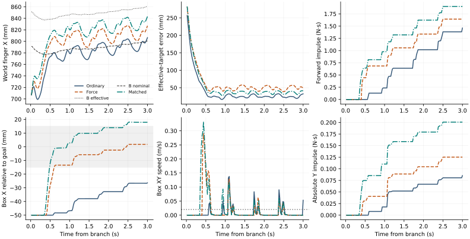

*Figure 3. Selected original placement 4101. The black curves in the first panel give B's nominal projected and effective pre-action world X; colored curves show actual fingers. Impulse integrates solved hand-on-box force. The speed threshold applies only to the last 0.1 s of the final position hold. B settled at 6.2 mm; C ended 24.2 mm away.* [Watch B](report_media/push_4101_B.mp4) · [Watch C](report_media/push_4101_C.mp4) · [Raw branch and warmup arrays](../artifacts/supplemental/push/replay/4101/) · [Actor, hand and base differences](supplement_push_pairs.csv)

Across the original twelve placements, A/B/C advanced their fingers 103/123/141 mm, delivered 1.17/1.65/2.01 N·s forward and 0.058/0.105/0.179 N·s absolute lateral impulse, and loaded the box for 0.183/0.248/0.296 s. Over the entire 3 s, forward forces averaged 0.391/0.549/0.670 N. Peak XY box speed averaged 0.113/0.250/0.312 m/s and peak acceleration estimated from consecutive 20 ms velocity samples was 5.42/8.38/8.72 m/s². Mean terminal downrange shortfall, counting zero when the box ended beyond the goal plane, was 30.0/7.2/0.08 mm. B moved the box 48.3 mm downrange on average, C 65.7 mm. Maximum overshoot averaged 5.5 versus 15.8 mm and peak cross-track excursion 6.0 versus 12.7 mm. B's effective tracking error was larger. No issued command hit the workspace boundary and no unwanted contact occurred. At the identical first state the elbow-0 and shoulder-1 actions differed by 0.132 and 0.078 actor units; before either branch loaded the box the fingers already differed by 18.0 mm RMS. Base paths differed by only 3.1 mm RMS across the push. These measurements support a change in arm coordination and impulse delivery. They cannot identify an internal learned stiffness. Seed 4109 illustrates the opposite endpoint ordering: B undershot by about 20 mm; C ended 4.1 mm away but reached 0.046 m/s in its final speed window. [Original scores](final_fixed_goal.csv) · [Mass transfer](supplement_push_heavy.csv) · [All trajectories and calibration cases](../artifacts/supplemental/push/)

### 5.4 Loaded walking with a fixed velocity and cable

Does a virtual base load improve tracking when a real cable opposes motion? Cases 100–111 varied walk speed (0.252–0.319 m/s), direction (about ±12°) and one of four physical towing fixtures, including 1–3 kg boxes and 8–14 cm starting slack. After one second of unloaded warmup each actor walked for 3 s with a neutral arm; B supplied ±16 N along the commanded walk, C used ±0.08 m/s ordinary speed. B/C effective velocities matched within 3×10⁻⁸ m/s at the same state. Disconnected twins kept identical warmups and left the box stationary.

| Treatment | Box travel, cm | Time to 25 cm, s | Effective-velocity RMS, loaded / disconnected, m/s | Mean / peak tension, N | Taut duty |
|---|---:|---:|---:|---:|---:|
| A | 63.36 | 1.60 | .0607 / .0512 | 5.67 / 50.36 | 74.4% |
| B +16 N | 80.68 | 1.34 | .0832 / .0689 | 5.93 / 58.85 | 76.1% |
| C +0.08 m/s | 85.24 | 1.29 | .0739 / .0643 | 6.00 / 61.39 | 76.0% |
| B −16 N | 45.98 | 2.03 | .0425 / .0425 | 5.28 / 41.20 | 72.3% |
| C −0.08 m/s | 41.50 | 2.12* | .0486 / .0391 | 5.15 / 37.30 | 70.7% |

Eleven of twelve negative-C runs reached 25 cm. Peak columns average episode peaks. In the first half-second after cable take-up, negative B/C velocity RMS was .029/.038 m/s. Negative B tracked better under load on all twelve pairs, but also walked 0.0157 m/s faster unloaded. The cable reduced their respective speeds by 0.0249/0.0239 m/s. A subsequent ordinary +0.016 m/s correction achieved .04279 m/s loaded RMS against B's .04251 m/s. B’s residual RMS tracking advantage over the calibrated command averaged 0.00028 m/s (paired 95% interval 0.00003–0.00055). The evidence supports a learned gait-speed bias with a useful operating point and near replication by ordinary calibration. [Towing and disconnected twins](fixed_policy_loads.md#tethered-locomotion) · [Velocity calibration](tow_velocity_correction.csv) · [Paired raw-policy effects](report_data/paired_policy_effects.csv)

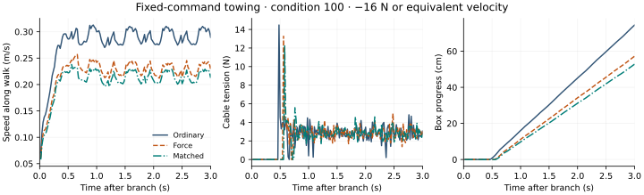

*Figure 4. Selected fixed-command condition 100, three treatments. Negative virtual base force changes the effective walking target. Physical tether tension fluctuates with gait.* [Trajectory sources](../artifacts/fixed_policy_loads/held/)

### 5.5 Standing and walking payload support

A rigid 4 cm-radius sphere's inertia and 0.365–0.987 kg mass were added at the finger COM, without a joint, grasp or new collision geometry. The added gravity load agreed with the finger Jacobian calculation to 10⁻¹⁰. Twelve paired load/posture conditions each used standing and 0.20 m/s forward walking. Sampled local targets had x = 0.30–0.42, y within ±0.05 and z = 0.03–0.12 m. After 2 s of warmup the arm held for 3 s with zero, +2 or −2 N vertical input, or an ordinary ±10 mm offset. A development ±8 N probe implied 40 mm of target shift for only millimetres of sag, motivating the smaller final command. Each treatment had its own same-command unloaded twin.

| Treatment | Mean loaded height, stand / walk (cm) | RMS from unloaded A posture, stand / walk (mm) | Nominal target RMS, stand / walk (mm) |
|---|---:|---:|---:|
| A | 70.37 / 70.52 | 12.88 / 12.94 | 13.95 / 12.04 |
| B upward | 71.35 / 71.50 | 5.53 / 5.41 | 13.62 / 13.54 |
| C raised | 71.32 / 71.48 | 5.74 / 5.58 | 13.50 / 13.41 |
| B downward | 69.39 / 69.54 | 22.57 / 22.74 | 19.75 / 16.95 |
| C lowered | 69.43 / 69.56 | 22.20 / 22.48 | 19.59 / 16.91 |

The unloaded A/B-up/C-raised world heights averaged 71.63/72.58/72.54 cm standing and 71.79/72.73/72.71 cm walking. Loaded effective-height RMS errors were 13.95/13.98/13.97 mm standing and 12.04/12.06/11.94 mm walking. Adding weight still lowered the upward-conditioned hand by 12.27/12.37 mm (stand/walk) relative to its **own** unloaded command. For raised ordinary reach the corresponding sag was 12.22/12.36 mm. Thus both restored absolute posture while incremental sag remained. The seven motors saw 9.1–9.3 N·m RMS effort; only the finger hit its limit. Walking saturation fractions were 1.69/1.55/1.76% over all motor–substep samples for A/B+/C+. Peak tilt was 8.32°. Gait adds vertical motion and changes the moving-root target; raising the arm slightly worsened both alternatives' walking nominal-height RMS. [Per-case masses, unloaded references, effort and saturation](fixed_policy_load_trials.csv) · [Payload construction and checks](../tests/fixed_policy_loads.py)

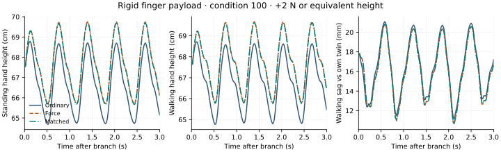

*Figure 5. One 0.876 kg load, condition 100. The paired curves differ in absolute height. The last panel subtracts each loaded run from its own unloaded twin. All twelve load/posture combinations contribute to the table.* [Raw trajectories](../artifacts/fixed_policy_loads/held/)

### 5.6 Physical EE disturbance and fixed wall contact

A world-downward force acted at the finger COM from 0.80 to 1.20 s. Twelve posture/load combinations (6.84–11.74 N) compared A with +2 N vertical conditioning and +10 mm matched reach held throughout. Twelve different cases (4201–4212) synchronized the same virtual or ordinary offset to the physical disturbance alone, after two development starts. Each branch's own undisturbed twin supplies the counterfactual height. Metrics below order the arms A/B/C.

| Schedule | Peak incremental drop (mm) | Nominal-height RMS during pulse (mm) | Peak arm-joint deviation (rad) | Recovery after removal (s) |
|---|---:|---:|---:|---:|
| Constant | 32.86 / 32.84 / 33.07 | 26.19 / 20.43 / 20.86 | .0470 / .0465 / .0468 | .668 / .668 / .673 |
| Synchronized | 33.39 / 33.45 / 33.63 | 29.3 / 21.8 / 21.7 | .0481 / .0475 / .0478 | .657 / .670 / .670 |

Recovery confirms 0.20 s within 5 mm of the twin. Both upward commands reduced absolute tracking error during loading. B had less incremental deflection than C on all twelve paired conditions in each protocol, but the differences averaged only 0.23 mm (constant) and 0.19 mm (synchronized). The synchronized B–C paired 95% interval was −0.22 to −0.15 mm on a roughly 33 mm excursion. A produced comparably small drops. These tests identify no stiffness/damping law. [Constant pulse](fixed_finger_pulse_trials.csv) · [Synchronized pulse](final_pulse.csv)

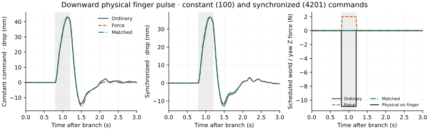

*Figure 6. One example per protocol: condition 100 at left, condition 4201 in the other panels. Shading denotes application of the physical force. The right panel overlays the prescribed physical world-Z load and virtual yaw-Z schedules; these inputs come from the validated pulse protocol, while the two deflection panels use measured height differences. The synchronized height traces were reproduced on the original binary and checked against all archived per-case scores.* [Original height traces](../artifacts/fixed_policy_loads/held/) · [Reproduced synchronized traces](report_media/)

For fixed **stationary wall contact**, two development starts preceded twelve new face placements and headings (5201–5212; x = 0.878–0.902 m, yaw within ±4°). After a common 2 s approach, A held local (0.42, 0, 0.01) m; B ramped virtual yaw-X to +10 N over one second; C ramped reach by 50 mm. Over the final 1.5 s, including zeros, A/B/C measured 4.00/4.76/4.51 N with loaded-substep duties of 24.8/27.2/27.6%. The longest uninterrupted >1 N interval in any branch was 90 ms. B had greater mean load than C on 11/12 pairs but greater duty on only three. Maximum substep force was 56.9 N, maximum tilt 6.91°, unwanted impulse zero. Effective-target-to-finger RMS distance over the scored hold was 33.7/37.8/39.5 mm. These stationary commands produced intermittent loading. Systematic lateral sliding used MPC; a fixed-command sliding cohort is unavailable. [Wall records](supplement_wall.csv) · [Setup and commands](../tests/supplement_wall.py)

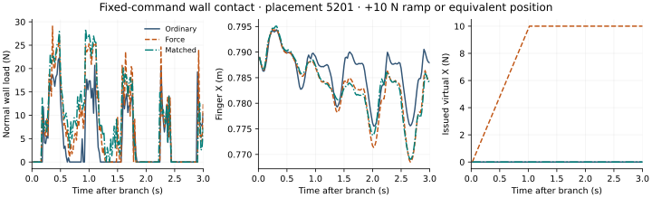

*Figure 7. A representative fixed hold. The issued virtual input ramps smoothly while measured wall load repeatedly returns to zero. The force acts on the wall along world +X; the virtual input is along yaw-frame X.* [All three held trajectories](../artifacts/supplemental/wall/5201/)

## 6. Predictive manipulation

The common manipulation command is world hand XYZ plus body forward speed, lateral speed and yaw rate. A task can add one goal-axis virtual force, one vertical component or three independently sampled yaw-frame components. Towing holds the EE neutral and samples three body rates, optionally plus two horizontal force components. All force comparisons retain the task cost.

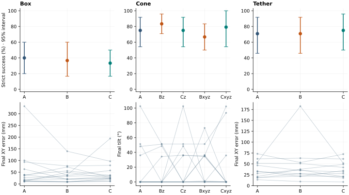

*Figure 8. Top: frozen general strict success with physical-scene bootstrap intervals. Bottom: every line gives one physical scene's mean endpoint over its two paired optimizer seeds. Box/tether use millimetres and cone uses degrees. Positional and matched arms share a color family across panels; axis labels identify dimensionality.* [Episodes](final_trials.csv) · [Intervals](report_data/mpc_groups.csv)

| General task · treatment | Strict successes (95% scene interval for rate) | Mean / median final error | B-only / C-only; joint solves | Joint mean time B−C |
|---|---|---|---|---:|
| Box A / B / C | 12 / 11 / 10 of 30 (20–60 / 17–60 / 17–50%) | 54.9 / 24.2; 39.9 / 31.0; 46.4 / 32.0 mm | 3 / 2; 8 | +0.99 s |
| Cone A / Bz / Cz | 18 / 20 / 18 of 24 (54–92 / 71–96 / 54–92%) | 19.8 / 0; 15.4 / 0; 22.8 / 0° | 4 / 2; 16 | +0.38 s |
| Cone Bxyz / Cxyz, same starts | 16 / 19 of 24 (50–83 / 54–100%) | 22.3 / 0; 19.3 / 0° | 3 / 6; 13 | +0.95 s |
| Tether A / Bxy / Cxy | 17 / 17 / 18 of 24 (46–92 / 46–92 / 50–96%) | 37.7 / 36.2; 47.2 / 35.8; 36.6 / 37.0 mm | 1 / 2; 16 | −0.09 s |

Semicolon-separated mean/median pairs follow treatment order. Cone zero denotes the recorded or rounded vertical endpoint. For B−C, paired success-rate differences in percentage points were +3.3 [−6.7, +13.3] box, +8.3 [−12.5, +33.3] vertical cone, −12.5 [−37.5, +12.5] XYZ cone and −4.2 [−16.7, +8.3] towing. Marginal success counts can conceal different solutions or identical solved pairs. [All 64 frozen contrasts and jointly successful times](final_pairs.csv) · [Stop reasons](report_data/mpc_status.csv)

### 6.1 Box pushing

The 1 kg cuboid has principal inertias 0.03417, 0.03417 and 0.02667 kg·m². An explicit box–floor friction pair is independent of hand friction. The destination is an XY offset from the settled center. Easy and medium spawns place the box roughly 1.04–1.34 m ahead with limited side offset. Extended, crossing and general tiers sample 1.75–2.45, 1.35–1.90 and 1.45–2.30 m, respectively; their absolute initial bearings span 0–25°, 30–70° and 55–110°. Global heading and object yaw vary. The 15 frozen scenes (3001–3015, three per tier) realized 1.04–2.23 m approaches and 0.125–0.575 m pushes. Time limits are 9, 15 or 20 s by tier. [Generator](../tools/box_scenario.py) · [Manifest](final_scenes.csv)

The bounded directional objective mixes mean and terminal squared box error to a local target advancing up to 8 cm. It ranks pre-contact approaches using the terminal finger distance to the rear face of the *rotated* footprint and a penalty when forward working clearance falls below 1 m. The face term has weight .05. If their combined guidance is g and b = max(remaining local distance², .015²), the contribution is bg/(b+g). As the box closes, a small positional benefit need not be overwhelmed by stance preference. Native failures and predicted nonhand impulse are ineligible. There is no reward for large commanded force. Box CEM uses 24 candidates, two elites, one iteration, 0.5 s horizon and five executed ticks. [Objective and selection](../tools/box_mpc.py)

The original 8, 35 and 50 cm demonstrations settled at 5.81, 3.03 and 9.80 mm. In early randomization, reducing 32 candidates to 24 retained 3/4 held-out settlements and reduced mean error from 25.8 to 17.6 mm. Forward-only control could lose the box sideways. On eight oblique/recovery starts forward, fixed geometric stance, fully sampled rates and guided CEM settled 0/3/4/4; on the four reserved starts the counts were 0/1/3/2. The project retained full rate authority. On the broader seven-start comparison the 24 × 0.5 s baseline settled 5/7, including a selected 66 cm push after a 2.02 m approach, ending 9.05 mm from goal. Two iterations with 16 candidates reduced development error but settled only 1/3 reserved scenes versus 2/3 for the reference. An equal-work 8 × 1.5 s screen and center-proximity costs also failed to establish an improvement. [Early randomized study](box_robustness.md) · [Snapshot recovery](contact_recovery.md) · [Guided comparison](guided_cem.md) · [Horizon and distribution study](general_box.md)

In the ten-condition 1/3/5 kg study (five geometries, some reused at different masses), A/B/C achieved **7/7/6** settlements as counts across ten runs per arm (see audit note below). The selected 5 kg easy-4/17, **with a known 5 kg model**, ended at 16.0/2.1/24.2 mm; B alone settled. Mean physical load on loaded ticks was 22.8/31.9/20.3 N, whereas signed total push impulse was 29.6/20.5/34.0 N·s. On oblique general-62 B sometimes asked for negative force while exerting positive downrange contact. Same-state replay matched effective targets within 0.098 µm yet changed actions. Independently replanned C could recover many tasks missed by fixed replay. [Mass-specific outcomes and replay](ee_force_box.md) · [All 30 episodes](force_box_trials.csv)

On the frozen suite the easy tier settled 5/6, 6/6, 4/6 for A/B/C; crossing settled 1/6, 0/6, 0/6. General settled 2/6, 1/6, 2/6. Mean maximum cross-track excursions were 66/70/71 mm, mean maximum overshoots 20/19/23 mm and final undershoots 18/3/14 mm. All three avoided unintended contact. Ordinary settled more often yet had a worse mean endpoint because of larger misses. A time-limited oblique run can make downrange progress while the hand repeatedly loads the wrong side. On development general-62/53 the arm spent 76% of control ticks at its radius cap; peak lateral error reached 112 mm and final error 215 mm. [Frozen outcomes](final_results.md) · [Oblique trajectory](../artifacts/general_box/baseline/general62/)

### 6.2 Cone uprighting and release

The freely moving SUMO cone weighs 3.36 kg, with principal inertias (0.25, 0.25, 0.09) kg·m² and COM 0.24 m up its axis. The physics includes plate, feet and shaft collisions. Near cases retain the 1.10–1.30 m forward placement with tip generally toward Spot. Varied and general scenes sample 1.18–1.50 and 1.22–1.60 m plate range at bearings up to ±28° and ±75°. General axial bearing covers 360°. Spawn height uses collision-geometry ground clearance, gravity settles the cone and the warmup checks support, overlap and speed. Four cases per tier (3101–3112) have a 12 s control limit. [Model, reset and physical checks](cone_uprighting.md)

For predicted local-axis alignment a, finger-to-COM distance d in metres and hand duty h, UniFP minimizes mean(1−a) + .005 mean(g), where g = d below a = .9 and .30h at or above it. Add .02[max(0, 1−minimum chassis gap/.04)]² over the closest forecast pass. Hard nonhand collision rejection remains active. The SUMO orientation-plus-proximity reward divided by −100 is exactly the first two terms with g = d everywhere; both use running means. UniFP's release and clearance changes alter what happens after alignment or before interference. The 16 × 1 s configuration fits three elites with the 3.5 noise ramp and one iteration. In the initial four development starts, continuous proximity reached the axis threshold 4/4 but released 0/4; switching to release guidance gave 4/4 releases. Of seven original starts, the first release objective solved five. Closest-4-cm clearance solved six, eliminated both original all-invalid stops, recovered seeds 5 and 6, and lost one previous success. On six varied/general holdouts both costs solved five. [Cost implementation](../tools/cone_mpc.py) · [Numerical reward comparison](ee_tracking_cone.md)

**Which contacts benefit from force?** Six snapshots on two scenes yielded 78 matched half-second branches at zero and ±12 N on X, Y and Z. At first shaft/plate load, ordinary removed 21.3° of tilt, +Z force 27.6° and its position match 20.3°. Once partially upright the same ordering became 31.0/12.8/22.8°. +X achieved 31.6° at first load but its ordinary offset achieved 34.1°. Y interventions showed no consistent advantage. In plate-only contact, ordinary/+Z/matched hand impulses of 0.93/3.21/0.72 N·s produced essentially zero rotation. Their signed angular impulses about support were −0.40/−0.90/−0.17 N·m·s. The support point is the normal-load-weighted centroid of active ground contacts; the projected hand moment uses the cone-axis × world-up direction. This measures the hand contribution about moving support and excludes gravity and ground torques. [Snapshot branches](cone_force_snapshots.csv) · [200 Hz wrench analysis](../tests/cone_contact_wrench.py)

In the earlier 12 fresh cones (301–312, one paired optimizer seed each), A/Bz/Cz/Bxyz/Cxyz released 8/9/10/10/9. In the later frozen cohort they released 18/20/18/16/19 out of 24. All frozen UniFP releases passed the whole-episode clean check. XYZ generated at least 10° of post-contact progress in 23/24 but ended six episodes with no valid plan, versus two for matched XYZ. On the earlier fresh cohort Z and XYZ requests were shortened on 69% and 61% of ticks; XYZ components were simultaneously above 1 N in magnitude on 54% of ticks. These were genuinely three-dimensional choices. The reversal between cohorts limits the case for either extra dimensions or a generally superior force axis. [Force trials and budgets](cone_force.md) · [Frozen arms](final_groups.csv)

**Optimizer sensitivity.** On one difficult outward-facing cone (82), ten new paired optimizer seeds 101–110 on the same scene yielded strict counts 0/4/0/0/2 for A/Bz/Cz/Bxyz/Cxyz. Successful Bz branches contacted on average 7.29 cm up the axis with +8.88 N·m·s projected impulse; failed Bz branches averaged 2.08 cm and −1.67 N·m·s despite longer contact. These are outcome-conditioned diagnostics. At seed 67, removing force from an already productive 7 s state still left all 16 hand/base candidates predicting ≥10° progress. On the stalled 43 rollout, 74/184 eligible conditioned candidates in sampled batches predicted contact, none predicted that progress. This locates a bottleneck in earlier contact discovery. Reserving four broader proposals gave ordinary 4/6 fresh releases versus 3/6 local; four correlated proposals gave 6/6. Drawing and discarding the proposal RNG values alone gave 5/6: only one gain was attributable to replacing draws against that sham. A 24-candidate retry on 82/43 still failed all five treatments. The frozen benchmark used the original local sampler. [Multi-seed and ablation study](exploration.md) · [Matched populations](cone_force_populations.csv)

### 6.3 Tethered transport

A two-site unilateral spatial tendon connects a torso hitch at local (−.42, 0, .08) m to a box eye at (.20, 0, .20) m. Its 0.70 m upper limit transmits tension. Passive stiffness, damping, friction and actuation are zero. A ray test rejects loaded cable segments intersecting collision geometry, along with direct robot–box contact. Slack shape, distributed cable mass and snag mechanics are outside the model. A free-flight impulse check and disconnected replay confirmed the origin of box motion. The latter displaced the box by less than 10⁻¹⁵ m. CEM optimizes base rates with neutral hand, optionally horizontal XY base force or matched velocity. A moving local box reference advances at 0.23 m/s toward the 0.80 m destination. The cost weights running and terminal squared box error equally, with a terminal cable-direction penalty weighted .15 min(1, remaining/.15)². This ranks useful take-up while the box is motionless. [Tendon validation](tether.md) · [Task cost](../tools/tether_mpc.py)

At 0.5 s the three development starts settled 1/3, 2/3, 2/3 for A/B/C. At 1 s all three solved all three, and each solved four of the five main cases. Longer prediction also lengthened the middle-knot ramp. On the 65° pull ordinary stopped with 24 interfering candidates; a fresh batch contained five legal trajectories. B/C towed the box but missed settling. Replacing four proposals with broader draws failed to recover strict completion on 65° or two other steep-bearing tests. The frozen 1 s / 24-candidate, two-elite rate planner used four scenes in each bearing band 0–15°, 15–35°, 35–55°, random signs, 1–3 kg, friction .27–.40, slack 4–14 cm and initial yaw ±18°. All 72 assigned outcomes enter. Strict successes by low/steep tier were 8/2 for A, 8/2 for B, 7/3 for C (eight assignments per tier). A and B solved exactly the same pairs. Mean tension was 3.47/3.46/3.54 N and maxima 53.3/57.0/58.3 N. Mean slack-to-taut threshold crossings were 89/90/91, including brief gait unloading. All six terminal invalid batches included predicted interference. Executed robot–box impulse was zero, peak roll/pitch below 9.1°. [Frozen trajectories](../artifacts/final/3212/) · [Development and failure checks](tether_trials.csv)

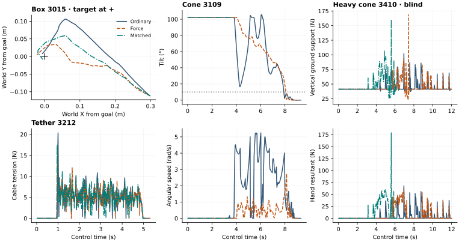

*Figure 9. Selected examples at optimizer seed 311. The XY panel is in world axes; time traces start after warmup and stop when each run stopped. Cone B/C denote vertical force and matched vertical position. In heavy 3410, C released while B remained loaded. The curves illustrate mechanisms; Figure 8 uses all assignments.* [Box 3015](../artifacts/final/3015/) · [Cone 3109](../artifacts/final/3109/) · [Heavy cone 3410](../artifacts/final/3410/) · [Tether 3212](../artifacts/final/3212/)

### 6.4 Wall contact: stationary regulation, repositioning and sliding

A fixed 4 m wide, 1.6 m tall vertical face is located around x = .89 m. The policy-tick force measurement averages four 5 ms normal loads, including free intervals. The cost averages squared **relative measured force error** and adds a terminal hand-to-face gap and base-position error scaled by 12 cm. A/B/C all control the complete arm target and planar body rates; B/C add one signed wall-normal proposal. At 24 candidates and a 0.5 s horizon, physical load is a consequence of a selected movement. A firm face at low setpoints sometimes made staying just clear preferable to an impact. All three treatments missed all eight main firm-face criteria. At a 5 N stationary target A/B/C averaged .97/1.35/1.62 N, RMSE 4.77/4.63/4.62 N, duty 9/12/14%. On a development and a held-out 15 N stationary start using a more compliant material, A passed both, B passed one, C neither. The material model has no measured real-wall calibration. [Wall objective, materials, hold windows and criteria](wall_contact.md) · [93 surface, cost and horizon records](wall_trials.csv)

A base-travel objective allowed the body to turn while leaving the finger near one part of the wall. The sliding objective added a terminal heading chord penalty scaled by 15° and a tangential finger–base offset penalty scaled by .08 m; yaw remained under optimizer control. Two shared physical placements at 15 N and 45 cm travel gave the following episode-weighted means. MAE and RMSE include unloaded samples.

| Wall objective, arm | Mean / MAE / RMSE, N | Loaded duty | Base error / finger tangential travel, cm | Peak heading excursion | Moving RMSE, N |
|---|---:|---:|---:|---:|---:|
| Reposition A | 13.15 / 5.24 / 6.65 | 92.8% | 2.1 / 38.8 | 48.1° | 5.40 |
| Reposition B | 13.75 / 4.88 / 6.30 | 93.7% | 1.5 / 26.8 | 26.0° | 5.96 |
| Reposition C | 13.44 / 4.90 / 6.24 | 93.8% | 1.6 / 35.8 | 36.2° | 5.43 |
| Slide A | 13.58 / 5.27 / 6.80 | 92.5% | 6.2 / 40.9 | 8.4° | 6.27 |
| Slide B | 13.27 / 5.10 / 6.58 | 92.9% | 8.8 / 36.1 | 8.0° | 6.06 |
| Slide C | 12.71 / 5.50 / 6.87 | 92.1% | 5.0 / 43.1 | 10.9° | 6.63 |

The heading change distinguishes lateral sliding from repositioning. Every sliding run missed the prespecified moving-RMSE threshold of 4.5 N. Nearly continuous loading and accurate instantaneous force regulation are different capabilities. On the selected original held-out B walk, traverse duty was 99.3%, goal error 1.1 cm and moving RMSE 5.65 N. The corresponding sliding B walk traveled −34.7 cm at the base and −34.2 cm at the finger. Compared with the original walk, it kept heading closer at the cost of base-goal accuracy. [Signed per-case motion and body-frame velocities](wall_sliding_trials.csv) · [Sliding trace and scores](../artifacts/uncertainty/wall/9/conditioned/)

### 6.5 Locomotion under known and unexpected physical loads

With neutral EE, CEM samples three body rates, optionally plus one signed horizontal base-force variable. The reference advances along a 90 cm path at .30 m/s (one .45 m/s stress case). The cost combines equal running/terminal squared path error and mean heading chord error with a .20 m lever arm. A torso-COM world-force input in MuJoCo produces the disturbance. A momentum check recovered (−18.975, +11.993) N for (−19, +12) N. Training's virtual base Z enters the actor but has no vertical linear-target term. Unloaded ±20 N Z probes changed actions slightly and standing height by at most 2.1 mm. The main study used horizontal forces.

All 27 primary walks met the final 0.5 s hold within 5 cm with bounded speed and posture. The nine conditions included free walking, 15/25 N opposing, 18 N lateral, faster reference, two rotated load cases and an unexpected pulse plus its unloaded twin. The latter two share one geometry. On four held-out conditions A/B/C mean path RMS was 4.30/4.64/4.42 cm. At 25 N opposing it was 7.86/8.26/7.87 cm; at the fast pace 18.64/19.52/18.75 cm despite endpoint success. A (−8,+22) N physical pulse started at 1.04 s and ended at 1.64 s inside control prefixes. The planner learned the changed load only at the next update. Maximum deviations from respective unloaded twins were 4.68/4.33/4.50 cm. Recovery after removal took 1.46/1.36/1.36 s. Two-axis B improved held-out lateral path RMS from 3.58 to 3.43 cm but ordinary achieved 3.20. All eight extra dimensionality checks settled. [Physical loads, poses, velocity and path errors](base_load_trials.csv) · [Task and calibrated velocity controls](base_load.md)

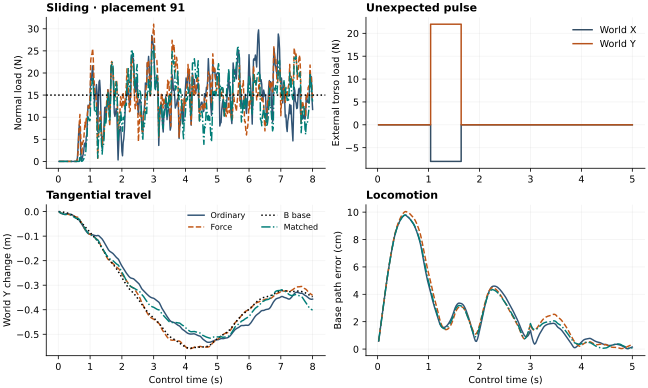

*Figure 10. Left: signed 45 cm slide, placement 91/67, three controllers. Right: one unexpected torso pulse and its three closed-loop path errors. All curves use time after warmup.* [Wall source](../artifacts/uncertainty/wall/9/) · [Walking source](../artifacts/base_load/held_pulse/)

## 7. Model uncertainty and prediction fidelity

Three questions require different controls. Changing a known object changes the physical task. Changing execution while keeping prediction nominal tests robustness to hidden physics. Restoring one executed snapshot and playing the **same** commands forward in both models measures prediction error without confounding later replanning. The informed twin uses the same execution plant as blind; only its planner receives accurate physical parameters. A better model can change which sequence of contacts wins CEM.

**Validation.** With separate, identical-parameter models, free-space, partial-history and loaded-contact continuations agreed bit for bit in issued commands, joint actions, poses, velocities, finger positions and contact measurements. Reordering candidates, reusing prior snapshots and failed-candidate isolation were tested. Informed selected prefixes on the heavy plants gave zero measured 100 ms XY and force error. A mass or friction change rebuilds dynamics on the receiving model. The supplemental extension scales ground sliding friction or torso mass and principal inertia with identical actuators and delay semantics. Arbitrary models with reordered joints or different delay queues are outside the supported transfer. [Native import](../native/rollouts.h) · [Transfer tests](../tests/check_model_transfer.py) · [Supplemental regression output](../artifacts/supplemental/uncertainty.log)

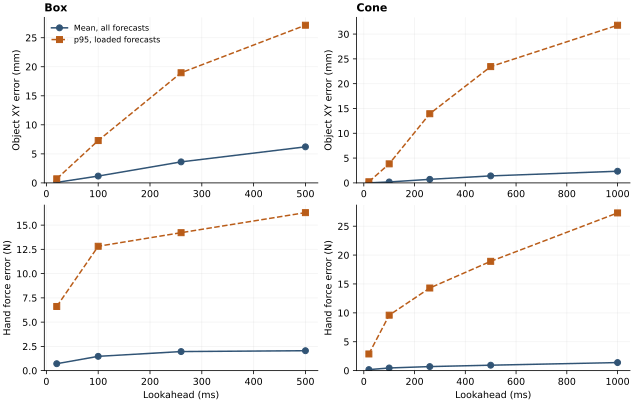

*Figure 11. Earlier common-schedule diagnostic. Per horizon, 1,796 mismatched box branches and 1,527 cone branches, clustered within executed episodes. Loaded means actual or predicted contact at that endpoint. The dashed line is a loaded-subset percentile; the solid line is an all-branch mean. Same-physics controls gave zero throughout. These are within-trajectory fidelity measurements.* [Branch summaries and contact timing](uncertainty_prediction.csv) · [Extraction](../tests/score_uncertainty.py)

At 20/100/260/500 ms, blind box mean XY errors grew from .09 to 1.18, 3.62 and 6.21 mm. Physical hand-force vector errors grew from .71 to 1.47, 1.96 and 2.05 N. At 500 ms, 8.6% of boxes' branch endpoints disagreed on contact and the loaded p95 XY error was 27.2 mm. Blind cone orientation errors were .003/.046/.201/.491° at those horizons and .942° at 1 s, with loaded p95 hand-force error 27.3 N at 1 s. At matched physics motion and contact were reproducible. Quiet intervals lower the all-branch mean. On three earlier fresh combined mass/floor perturbations (1.7 kg actual vs 1 kg nominal, floor coefficient ×1.4), all controllers settled two boxes. For the same plants with informed prediction A/B/C settled 1/2/2 of three; ordinary missed one hold even at 3.0 mm final error. [Mismatch pilot](model_uncertainty.md) · [85 individual trials](uncertainty_trials.csv)

### Frozen force-sensitive challenges

Each cell gives strict count out of twelve / mean error including failures. These are six independent geometries with two optimizer repeats per family. Five-kilogram boxes preserve geometry and scale cuboid inertia; cones scale mass and principal inertia together. Comparing rows within a task keeps the actual plant, scene and optimizer seed fixed.

| Executed plant | Predictor | A ordinary | B force | C matched |
|---|---|---:|---:|---:|
| 5 kg easy box | Blind, 3 kg | 7 / 29.7 mm | 6 / 18.6 mm | 7 / 16.6 mm |
| Same heavy box | Informed, 5 kg | 8 / 22.5 mm | 7 / 22.5 mm | 5 / 25.9 mm |
| 4.20 kg outward cone | Blind, 3.36 kg | 0 / 101.4° | 0 / 102.4° | 1 / 93.9° |
| Same heavy cone | Informed, 4.20 kg | 1 / 93.9° | 1 / 93.6° | 1 / 93.9° |

Within box arm A/B/C the blind-only versus informed-only counts were 1:2, 1:2 and 4:2. The blind 100 ms XY RMS errors averaged 2.36/2.32/2.27 mm; physical hand-force RMS errors 4.09/4.01/3.30 N. With correct physics all became zero. Heavy cones averaged only 0.26/0.14/0.21 mm blind XY forecast error at 100 ms. A/B/C achieved ≥10° useful progress in only 1/1/2 runs; hand loading was concentrated 2.2/2.2/2.6 cm up the axis. Mean signed hand angular impulses were −0.32/−0.34/+1.00 N·m·s despite substantial hand impulse (43.4/41.2/37.8 N·s). B's eligible fraction averaged 98%. The planner could predict a stuck object accurately and still lack a useful manipulation trajectory. With only six geometries, zero successes on either seed leaves a one-sided 95% upper bound of about 39% on the chance of at least one success on a similarly drawn geometry. [Heavy-plant scores and moments](final_trials.csv) · [Blind/informed contrasts](final_pairs.csv)

Historical 82/101 remained a **selected** force-specific capability: vertical force released even with the hidden 25% cone mass increase, in 9.3 s, at +11.86 N·m·s versus −1.34/−2.44 for A/C. Two other optimizer seeds on that scene failed all arms. In frozen heavy scene 3410/311 the opposite occurred: B achieved +11.94 N·m·s but ended at 102.45°; C made contact farther up the axis (8.3 vs 3.8 cm) and released in 6.5 s after translating the cone 47.5 cm. Integrated angular impulse alone is insufficient for clean release.

### Supplemental environmental and robot changes

Three fresh boxes (5501–5503) and three cones (5511–5513), CEM 451, used one change at a time after six development runs. The ground-foot coefficient fell from 1.0 to .55 while the explicit box–floor pair and cone priority preserved object friction. Separately, +20% torso mass and inertia added 3.342 kg at the original COM. Neither change was disclosed to the nominal predictor. Each cell below orders A/B/C. Each count is out of three; the same placements recur between plants.

| Task and execution change | Successes | Mean final error | 100 ms hand-force RMS prediction error, N |
|---|---|---|---|
| Box nominal | 1 / 1 / 2 | 98.7 / 52.1 / 12.4 mm | 0 / 0 / 0 |
| Box lower traction | 2 / 1 / 0 | 10.6 / 90.4 / 60.7 mm | .76 / .48 / 1.40 |
| Box heavier torso | 1 / 1 / 0 | 42.1 / 22.0 / 47.5 mm | 1.33 / 1.21 / 1.39 |
| Cone nominal | 3 / 3 / 2 | <.01° each | 0 / 0 / 0 |
| Cone lower traction | 2 / 3 / 3 | 34.2 / <.01 / <.01° | 1.96 / 1.06 / 1.62 |
| Cone heavier torso | 2 / 1 / 3 | 23.0 / 46.9 / <.01° | 5.38 / 3.76 / 3.15 |

B alone settled heavy-torso crossing box 5503 at 10.3 mm versus A/C 72.5/88.0 mm. On low-traction boxes B had the smallest force forecast error and the largest mean goal error. The informed twins restored exact prefix physics but did not monotonically improve success. On one heavier-torso box all three failures became successes; on one cone C lost its release. These results support sensitivity to contact choices and physical parameters, with no consistent robustness ordering. No inter-simulator or hardware transfer conclusion follows. [Paired video, hidden torso load](report_media/torso_5503_451.mp4) · [All 72 records and model digests](supplement_mismatch.csv) · [Execution/prediction protocol](../artifacts/supplemental/uncertainty/protocol.json)

## 8. Direct comparison with SUMO/ReLIC

The local adapter compiles the same 1 kg cuboid, dimensions, inertia, independent box–floor pair and hand friction into both ReLIC execution and prediction. Cone geometry, mass, COM and contact parameters match the SUMO asset. The common XY goal is offset from settled UniFP object position; ReLIC uses its own settled object height for its 3D reward. Each robot has its own collision geometry, valid posture, actuator state and neutral warmup. Cone post-warmup XY differed by at most 1.12 mm between systems. An observer measures solved contact immediately after native integration at 100 Hz for ReLIC; UniFP integrates at 200 Hz. The adapter checked compiled parameters, passive support, box momentum residual (<.0012 N·s/tick in development), bitwise unchanged motion with observer disabled and common scoring on 85 archived UniFP runs. The registered simplified SUMO box config and inherited success predicate disagree on the goal field; external physical scores are used throughout. [Common fixture and observer methods](final_methods.md) · [Adapter](../tests/sumo_common.py) · [Observer](../tests/sumo_observer.c)

ReLIC supplies 12 leg actions from 84 network inputs. Its registered controller requests vx, vy, yaw rate (±.7 in the respective units) and seven direct arm joint targets, with closed gripper. It executes the updated CEM mean. SUMO box reward uses average object-goal and gripper-center distances, and squared mean object speed with weights 60, 4 and 20; its cone reward uses axis/proximity weights 100 and .5. UniFP executes its best eligible candidate and learns all 19 joints. Registered SUMO permits early incidental contacts that UniFP rejects in its forecasts. Different robot models, costs, command authority, optimization and termination policies remain material to the interpretation.

| System and protocol | Box strict / clean (of 30) | Mean error, mm | Cone native upright (of 24) | Cone strict / clean (of 24) | Mean end tilt |
|---|---:|---:|---:|---:|---:|
| UniFP ordinary | 12 / 12 | 54.9 | 19 | 18 / 18 | 19.81° |
| UniFP goal-axis box / vertical cone force | 11 / 11 | 39.9 | 20 | 20 / 20 | 15.44° |
| UniFP matching offsets | 10 / 10 | 46.4 | 19 | 18 / 18 | 22.84° |
| UniFP XYZ force / matched (cone only) | — | — | 17 / 20 | 16 / 16; 19 / 19 | 22.28 / 19.29° |
| Native ReLIC, 20 Hz | 21 / 18 | 12.7 | 24 | 9 / 1 | 0.53° |
| Equal scheduled work ReLIC, 10 Hz | 1 / 0 | 75.8 | 23 | 19 / 4 | 3.52° |
| Runtime-comparable ReLIC, 10 Hz, **supplemental** | 17 / 10 | 31.6 | 23 | 15 / 1 | 4.86° |

Native ReLIC gained eleven box settlements and lost two against ordinary UniFP (+30 percentage points, 95% paired scene interval +6.7 to +53.3). On their ten joint successes it settled 3.21 s earlier. On cone release ordinary UniFP gained twelve and lost three (+37.5 points, +8.3 to +66.7); native ReLIC was 2.75 s faster on their six joint releases. The equal-work box allocation used only six samples over 2 s. It yielded just one strict success; matched-work cones performed much better. The four frozen latency-subset runs (two per task) scored 0/2 and 1/2 for box/cone and ran considerably faster than the UniFP reference. They remain in the frozen cohort.

**Supplemental runtime calibration.** Only the development boxes easy-4/17, medium-1202/223 and cones near-0/17, general-82/43 informed allocation. Box 20 × 2 s and 40 × 1 s gave p95 48.2/48.1 ms; cone 24 × 2 s and 48 × 1 s gave 67.4/70.8 ms. Candidates qualified within ±20% of 43/61 ms. Development strict success, clean success, error and latency proximity governed selection in that order. Both selected the 2 s horizon. Against ordinary UniFP on the existing common suite, runtime ReLIC gained/lost 10/5 boxes and 1/4 cones. Its paired strict differences were +16.7 points [−10.0,+43.3] box, −12.5 [−29.2,+4.2] cone. ReLIC completed the seven jointly solved boxes 2.20 s earlier on average and the fourteen joint releases 2.73 s earlier. Unintended contacts occurred in 11/30 boxes and 22/24 cones, with two unstable cone terminations. Mean ReLIC impulses in these two tasks were 27.8 and 157.7 N·s, versus 15.5 and 83.5 for ordinary UniFP. This is a supplemental comparison on reused physical assignments. [Calibration lock](../artifacts/supplemental/sumo/runtime_lock.json) · [All 54 outcomes](supplement_runtime.csv) · [Twelve paired contrasts and intervals](report_data/runtime_paired_intervals.csv)

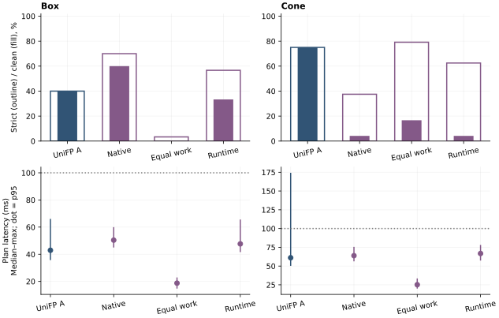

*Figure 12. Each allocation uses the same 30 box and 24 cone assignments. The outlines show strict success and the filled bars add the whole-episode clean condition. Below, dots give p95, vertical segments span median to maximum. Native ReLIC's own deadline is 50 ms. Work and runtime ReLIC use 100 ms.* [Frozen groups](final_groups.csv) · [Supplemental pooled timing](supplement_runtime_groups.csv)

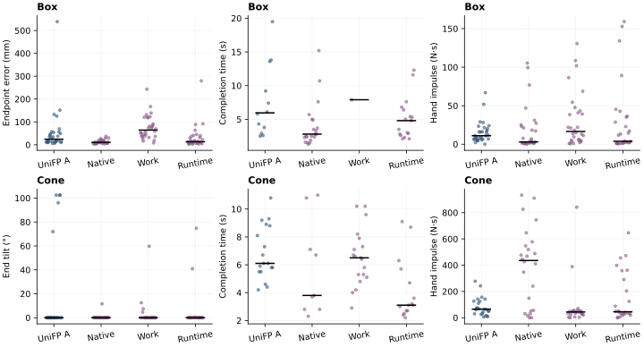

*Figure 13. Each dot is one assignment, black bars mark medians. All endpoints and impulses enter. The middle panels contain only successful runs; the paired times in the text use joint successes. A low end tilt can coexist with an unsuccessful hand-free hold.* [Frozen trials](final_trials.csv) · [Supplemental trials](supplement_runtime.csv)

**Why tipping and release differ.** All 24 native ReLIC cones crossed the upright threshold. Fourteen of fifteen strict failures had active hand contact in the last half-second; hand contact alone broke the final hold in six. Eight failed angular speed, two continuous support, and one final posture/tilt (overlapping causes). The remaining hand-free failure, 3107/337, tipped and fell. All fifteen failures and eight of nine releases incurred earlier unintended contact. The native mean hand impulse was 389 N·s. On two development scenes a local reward ablation replaced persistent COM proximity with a shortfall to 0.30 m finger distance once alignment reached .9. First upright times remained 1.14/2.78 s; strict releases occurred at 2.9/3.7 s where the registered reward timed out. Only near-0 was clean. The ablation identifies a contribution of the objective on these two starts; it supplies no calibrated held-out success estimate for a modified ReLIC system. [Paired cone video, common fixture](report_media/relic_cone_3109_311.mp4) · [Final hold decomposition](supplement_release.csv) · [Development-only pairs](supplement_release_dev.csv)

## 9. Computational performance

A policy evaluation is one neural action in a simulated rollout. UniFP takes four physical integration steps per evaluation, ReLIC two. Scheduled work includes all requested candidates. Actual work counts completed policy ticks, including candidates later excluded by the cost/constraints. ReLIC's native cutoff could fill a suffix, so the observer counted integrations rather than inferring completion from array shape. All scheduled calls completed in the reported frozen and full supplemental ReLIC blocks. Simulated completion time is a task outcome; wall-clock planning and synchronous live-cycle latency measure computer performance. The latter includes live execution overhead and, where instrumented, scoring. Videos were rendered offline.

| Configuration | Calls/update · frequency | Planning p50 / p95 / maximum, ms | Native misses / updates | >100 ms |
|---|---|---|---:|---:|
| General UniFP box | 600 · 10 Hz | 35.7–35.9 / 42.9–43.1 / 54.0–93.1 | 0 / 10,394 | 0 |
| General UniFP cone | 800 · 10 Hz | 50.1–50.6 / 59.6–63.4 / 130.0–196.4 | 49 / 8,193 | 49 |
| General UniFP tether | 1,200 · 10 Hz | 68.6–69.2 / 80.2–81.3 / 90.9–96.6 | 0 / 4,681 | 0 |
| ReLIC box, native / work | 2,400 · 20 Hz / 600 · 10 Hz | 45.0 / 50.4 / 60.0; 14.7 / 18.7 / 22.9 | 287 / 4,362; 0 / 3,959 | 0 |
| ReLIC cone, native / work | 2,400 · 20 Hz / 800 · 10 Hz | 56.3 / 63.9 / 75.6; 20.0 / 25.2 / 33.5 | 3,962 / 4,432; 0 / 1,659 | 0 |
| ReLIC runtime box / cone | 2,000 / 2,400 · 10 Hz | 41.6 / 47.7 / 65.6; 57.3 / 66.8 / 78.2 | 0 / 2,775; 0 / 1,584 | 0 |

UniFP ranges span controller arms. Native ReLIC uses three knots, three elites, ramp 3.5, 24 candidates and 2 s, with alternating 2/3 policy ticks per 50 ms nominal prefix. Equal-work uses 6/8 candidates on box/cone, runtime uses 20/24. Native ReLIC exceeded its own period on 89.4% of cone updates. Runtime ReLIC was 11%/9% slower in planning p95 than ordinary UniFP on box/cone. Its synchronous cycle p95/max was 51.5/69.4 and 71.3/83.0 ms, zero cycle misses. It completed 5,550,000/3,801,600 rollout calls (twice as many physics steps) plus 27,750/15,840 post-warmup live physics steps. Frozen general UniFP, challenge UniFP and ReLIC used 18,408,000, 9,381,200 and 25,512,200 rollout calls. The challenges had zero >100 ms plans over 12,870 updates. The old four-run runtime subset reached p95 35.0/43.8 ms on box/cone. For ordinary box MPC the recorded synchronous cycle median/p95/max was 37.6/44.9/68.4 ms with zero misses over 3,355 replans. Frozen general cone and tether archives retain planning times only. [Recomputed plan and cycle distributions](report_data/pooled_timing_ms.csv) · [Pooled work and timing](final_groups.csv) · [Runtime cycle measurements](supplement_runtime_groups.csv)

**What limits the budget?** The isolated rollout microbenchmark used 21 warm repeats per cell. For 32 × 25 policy ticks, one/four/eight workers gave median 261.6/68.4/48.3 ms, p95 266.3/71.0/53.3 ms. The last median corresponds to about 16,600 simulated policy ticks/s for the batch. Mean serial time per candidate was 4.80 ms inference and 3.33 ms physics/contact; concurrent worker times overlap. Eight workers consumed 5.87 cores on average, median snapshot time .015 ms. This timer excludes Python CEM generation/scoring and live execution. The main tables include state transfer, sampling, rollout, cost, fit and selection. A prior paced viewer test had 67.1–71.7 ms plan p95 vs 51.4–53.9 ms headless for the same 97 updates; 12.7 simulated seconds took 13.48/5.11 wall seconds. Neither an isolated neural-call rate nor headless p95 is a hard real-time guarantee. On six forecast-recording references physical commands and trajectories reproduced exactly. No controlled universal telemetry-overhead estimate is available. [Worker samples](../artifacts/rollout_benchmark.csv) · [Viewer timing](live_box.md) · [Forecast recording validation](episode_telemetry.md)

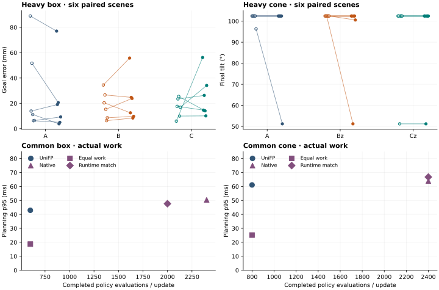

*Figure 14. Upper panels: each segment joins the blind (open) and informed (filled) endpoint on one heavy scene, averaged over its two paired seeds, for the same physical plant. Lower panels: actual evaluations per replan and measured pooled p95 for the four common-suite allocations. UniFP uses four physics steps per call and ReLIC two. Native ReLIC replans twice as often. Overlapping work counts can have very different runtime.* [Frozen trial data](final_trials.csv) · [Measured work](final_groups.csv) · [Runtime calibration and work](supplement_runtime_groups.csv)

## 10. Failure mechanisms and conclusions

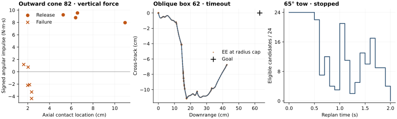

*Figure 15. Left: the ten local Bz optimizer seeds on one outward cone, grouped by eventual strict outcome. Middle: ordinary general-62/53 missed sideways despite advancing toward the goal. Orange points mark an issued EE radius at the 0.55 m cap. Right: the final 65° ordinary towing batch contained no safe command. Points and timestamps are diagnostic observations within those scenes.* [Cone episodes](exploration_trials.csv) · [Box path](../artifacts/general_box/baseline/general62/) · [Tow rejection counts](../artifacts/tow_1s/side/off/)

**Tracking and continuity.** World requests can lie outside the instantaneous yaw-frame sphere. Projection, base motion, soft policy tracking and external contact separate the requested point from the physical finger. On cone 82 the raw request was projected on 92% of ticks; p95 raw-to-projected and projected-to-finger distances were 60.3 and 19.5 cm. Raw target increments at prefix boundaries were zero. Physical finger speed p95 was .607 m/s both at prefix starts and within prefixes. In another cone run the actual finger reached 1.16 m/s just after unloading from 31.5 N. The visual gap mixes real dynamics and large changes in hypothetical future commands. Neither a jump in the physical finger nor a need for extra command smoothing follows solely from a plot of the raw target. [Tracking diagnostics](ee_tracking_cone.md)

**Optional parameterization.** Choosing effective EE position first and subtracting proposed F/200 could decouple position intent from force in candidate sampling. On two archived winning trajectories per task used as development material, that inverse placed the nominal endpoint outside the workspace on 576/1,400 box ticks and 2,281/7,150 cone ticks. It exceeded nominal slew on 96/1,344 and 1,050/7,007 adjacent within-plan intervals. A fair implementation would need coupled constraints on both schedules and on the reachable segment. The study ended at feasibility analysis. There is no closed-loop performance claim for the inverse parameterization. [Feasibility counts](supplement_inverse.csv)

| Research question | Answer supported by this project |
|---|---|
| 1. Can predictive manipulation transfer to UniFP without retraining? | Yes. With stateful policy/actuator rollouts, a common command interface supported box translation, cone rotation/release and cable transport, plus wall and loaded-walking tasks. |
| 2. What useful capability does force conditioning provide? | At an equal reachable reward target it changes the actor's joint coordination. In fixed-goal pushing it repeatedly delivered a more suitable impulse and left more boxes settled. |
| 3. Can MPC exploit something beyond ordinary target offsets? | Yes in selected runs and on some paired comparisons, most clearly vertical-force contact discovery on cone 82. On frozen general cones Bz gained four and lost two releases versus Cz. These data do not support a general advantage. |
| 4. Which interactions benefit? | The short, specified-goal push and some transitions into productive lower-shaft contact. Positive or negative force is neither invariably helpful nor equivalent to larger mechanical load. Ordinary calibration explains most of the towing difference and most absolute payload-height improvement. |
| 5. How robust is the architecture to physical uncertainty? | Replanning can finish under unknown mass, traction or inertia. Force-specific successes and losses both recur. Forecast improvement with informed physics is demonstrable; its task-success effect depends on geometry, cost and sampled actions. |
| 6. How does it compare with SUMO? | Native ReLIC settled more boxes and tipped every general cone; UniFP achieved more strict and clean releases. Equal-work and runtime comparisons give different orderings. Direct arm authority, objectives, periods and safety handling all differ. |
| 7. What computational limits remain? | Eight CPU workers usually meet the 100 ms target at task-specific budgets. Longer horizons reduce affordable diversity; cone planning has genuine deadline tails. More samples alone failed to recover several hard contact configurations. |

Replanning gives all three arms repeated opportunities to correct position, velocity and contact geometry. A fixed-schedule difference can therefore be real and useful yet small in independently optimized MPC. This is a plausible explanation consistent with the ablations; the study did not isolate the value of feedback against a nonpredictive controller. Simulation observability, one pretrained checkpoint, one hardware environment, simplified tether and wall materials, small physical-scene counts and strong seed dependence bound generalization. A useful subsequent test would measure how often each controller acquires a shaft contact that can both tip **and release** a cone, with greater physical-scene diversity and a prespecified paired analysis. Ordinary position/velocity remains a defensible default.

## 11. Verification and reproducibility

All 15 figures are available in vector PDF and SVG with PNG previews. The gallery's 31 MP4s were decoded start to finish and indexed by checksum. The [gallery](video_gallery.md) gives treatment, condition, outcome and data provenance for the selected recordings.

The report analysis rescored all 538 frozen trajectories and 54 supplemental ReLIC trajectories at physical tick boundaries, checked endpoint errors, frozen lock digests, 29 frozen groups and all 64 archived paired endpoint means and discordant counts. It independently classified all 132 original, fresh and transferred fixed-goal branch traces at the end of their schedules. The supplemental SHA-256 manifest passed before rendering. One synchronized pulse condition was reproduced only to recover missing time series; all three rows matched its archived numerical measurements. Other new recordings use saved poses or measurements. The statistics and reporting tools write to separate output directories. [Report analysis](../tools/report_statistics.py) · [Tables, inputs and checksums](report_data/) · [Pulse and camera reproduction](../tools/report_recordings.py)

**Audit notes.** The frozen scene manifest supersedes the twelve-box *proposal*. The four original runtime-calibrated ReLIC episodes remain in the 538; the subsequent 54-run comparison is separate. The historical 5 kg easy-4 result depends on model knowledge: with a 5 kg predictor B alone settled (A/B/C errors 16.0/2.1/24.2 mm); with a 3 kg predictor A and B settled (9.8/8.3/20.9 mm). The later frozen summary's shorthand about ordinary and force settling needs that qualifier. The supplemental provenance field named `checkpoint_sha256` identifies the exported ONNX graph. Its digest begins `4b1f0b65`; the iteration-5300 training checkpoint begins `81ba5baf`. The full identities, exclusions, exact command schedules, raw telemetry caveats and reproduction commands are in the evidence guide. [Known-mass data](force_box_trials.csv) · [Blind/informed data](uncertainty_trials.csv) · [Evidence guide](research_evidence.md) · [Representative recordings](video_gallery.md)
